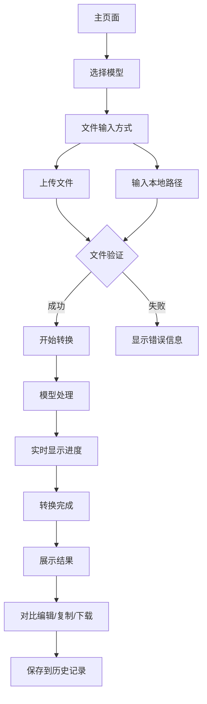

## 1. 产品概述
本地语音转文字Web应用，专为Mac Mini M4优化，支持多种主流语音识别模型。用户可通过网页界面选择不同模型（MLX-Whisper、Faster-Whisper、FunASR）进行高效的语音转文字处理，支持文件上传和本地路径直接读取两种模式。

解决用户在Mac Mini M4设备上进行多语言语音转文字的需求，提供简单易用的单页面Web界面，无需依赖云端服务，保护隐私的同时提供高质量的识别结果。支持中文、英文等多种语言的精准识别。

## 2. 核心功能

### 2.1 用户角色
无需用户注册，所有用户均可使用基础功能。

### 2.2 功能模块
本应用采用单页面设计，所有功能集成在：
1. **主页面**: 模型选择、文件输入、转换控制、结果展示、历史记录。

### 2.3 页面详情
| 页面名称 | 模块名称 | 功能描述 |
|---------|---------|----------|
| 主页面 | 模型选择区 | 选择MLX-Whisper、Faster-Whisper、FunASR等模型，显示各模型特点和适用场景 |
| 主页面 | 文件输入区 | 支持拖拽上传、点击选择文件，或直接输入本地绝对路径，支持批量处理 |
| 主页面 | 转换控制区 | 开始转换按钮、实时进度显示、预计剩余时间、取消转换、暂停/继续功能 |
| 主页面 | 结果展示区 | 分栏显示原文和识别结果、支持对比编辑、一键复制、导出多种格式 |
| 主页面 | 历史记录区 | 折叠式侧边栏显示历史记录、支持搜索筛选、批量操作、重新转换 |
| 主页面 | 设置面板 | 模型参数调整、语言选择、输出格式设置、快捷键配置 |

## 3. 核心流程
用户操作流程：
1. 用户进入主页面，选择适合的语音识别模型（MLX-Whisper/Faster-Whisper/FunASR）
2. 选择文件输入方式：上传本地音频文件或直接输入本地文件路径
3. 系统验证文件格式、大小和路径有效性
4. 用户点击开始转换，后端加载对应模型
5. 模型处理音频文件，实时显示转换进度和中间结果
6. 转换完成后展示文字结果，支持原文对比和编辑
7. 用户可复制、编辑、下载或导出转换结果
8. 转换记录自动保存到历史记录，支持后续查看和管理

## 4. 用户界面设计

### 4.1 设计风格
- **主色调**: 深灰色(#1a1a1a)配合苹果风格的浅灰色(#f5f5f5)
- **强调色**: 蓝色(#007AFF)用于主要按钮，绿色(#34C759)用于成功状态
- **按钮样式**: 圆角矩形，悬停效果，符合macOS设计语言，支持深色模式
- **字体**: San Francisco字体，标题18px，正文14px，等宽字体用于显示识别结果
- **布局**: 单页面应用，顶部工具栏，左侧配置面板，中央工作区，右侧历史侧边栏
- **图标**: 使用SF Symbols风格图标，支持动态图标显示处理状态

### 4.2 页面设计概览
| 页面名称 | 模块名称 | UI元素 |
|---------|---------|--------|
| 主页面 | 模型选择区 | 卡片式模型选择器，显示模型名称、特点、语言支持、处理速度对比 |
| 主页面 | 文件输入区 | 支持拖拽上传（虚线边框）和路径输入框，批量文件显示为列表，支持删除单个文件 |
| 主页面 | 转换控制区 | 大号开始按钮带环形进度指示，实时显示处理速度和预计时间，支持暂停继续 |
| 主页面 | 结果展示区 | 分栏布局，左侧原文音频波形，右侧识别结果，支持同步滚动和高亮对应 |
| 主页面 | 历史记录区 | 可折叠侧边栏，显示最近记录，支持搜索和筛选，显示处理模型和准确率 |
| 主页面 | 设置面板 | 弹出式设置窗口，包含语言选择、输出格式、模型参数等高级选项 |

### 4.3 响应式设计
桌面优先设计，针对Mac Mini M4优化，支持大屏幕显示器。最小宽度支持1440px，充分利用大屏幕空间展示更多信息和对比结果。支持分栏布局调整和面板大小自定义。

### 4.4 性能优化
- 使用Bun作为包管理工具，提升开发效率和运行性能
- 前端使用React + Tailwind CSS，确保界面响应迅速
- 后端采用FastAPI，提供高性能的API服务
- 模型加载采用懒加载策略，首次使用时才加载到内存
- 支持批量处理和队列管理，优化多文件转换效率