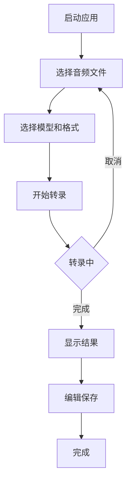

## 1. Product Overview
本地语音转文字桌面应用，支持多种输出格式和AI模型选择。为内容创作者、记者、学生等需要高效转录音频的用户提供离线、安全、高质量的语音转文字服务。

## 2. Core Features

### 2.1 User Roles
无需用户注册，本地使用，无角色区分。

### 2.2 Feature Module
核心功能页面：
1. **主界面**: 文件选择、模型选择、输出格式选择、转录控制、结果显示。

### 2.3 Page Details
| Page Name | Module Name | Feature description |
|-----------|-------------|---------------------|
| 主界面 | 文件选择区域 | 拖拽或浏览选择音频文件，支持常见格式(mp3, wav, m4a, flac)，显示文件信息和时长 |
| 主界面 | 模型选择器 | 下拉选择MLX-Whisper、FunASR、Faster-Whisper等模型，显示模型大小和预计处理时间 |
| 主界面 | 输出格式选择 | 单选按钮组选择SRT字幕、纯文本、Markdown格式，预览输出效果 |
| 主界面 | 转录控制面板 | 开始/暂停/取消转录按钮，实时进度条，预计剩余时间显示 |
| 主界面 | 结果展示区 | 可编辑的转录文本区域，语法高亮，时间戳显示，一键复制/保存 |
| 主界面 | 设置面板 | 语言选择、输出目录设置、快捷键配置、模型下载管理 |

## 3. Core Process
用户操作流程：
1. 启动应用，主界面自动加载
2. 选择音频文件（拖拽或浏览）
3. 选择AI模型和输出格式
4. 点击开始转录，查看实时进度
5. 编辑和校对转录结果
6. 保存到指定位置

## 4. User Interface Design

### 4.1 Design Style
- 主色调：深灰色(#1a1a1a)背景，亮蓝色(#007acc)强调色
- 按钮风格：圆角矩形，悬停效果，扁平化设计
- 字体：系统默认字体，等宽字体用于代码/转录文本
- 布局：左侧控制面板，右侧结果展示的分栏布局
- 图标：简洁线性图标，符合macOS/Windows设计规范

### 4.2 Page Design Overview
| Page Name | Module Name | UI Elements |
|-----------|-------------|-------------|
| 主界面 | 文件选择区域 | 拖拽区域带虚线边框，文件列表显示文件名、大小、时长，删除按钮 |
| 主界面 | 模型选择器 | 下拉菜单带模型说明，显示模型大小和语言支持，下载进度条 |
| 主界面 | 输出格式选择 | 三个互斥的卡片式选项，带格式预览图标 |
| 主界面 | 转录控制面板 | 大号开始按钮，进度条带百分比，速度和时间预估显示 |
| 主界面 | 结果展示区 | 语法高亮的文本编辑器，时间戳可折叠，查找替换功能 |

### 4.3 Responsiveness
桌面优先设计，适配macOS和Windows系统界面规范，支持窗口大小调整，最小宽度800px。

### 4.4 Desktop App Considerations
- 支持系统托盘最小化运行
- 全局快捷键支持（开始/暂停转录）
- 文件关联支持（双击音频文件自动打开应用）
- 系统通知提醒转录完成
- 离线运行，无需网络连接