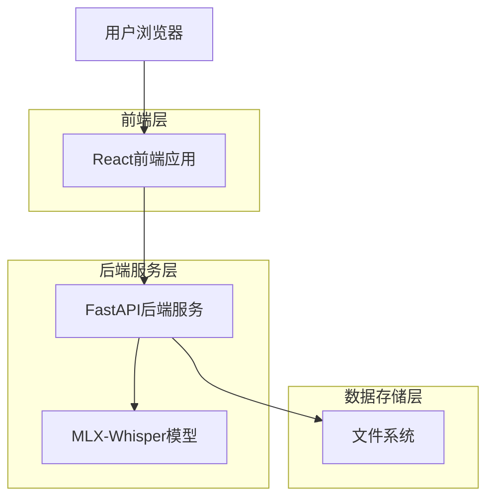
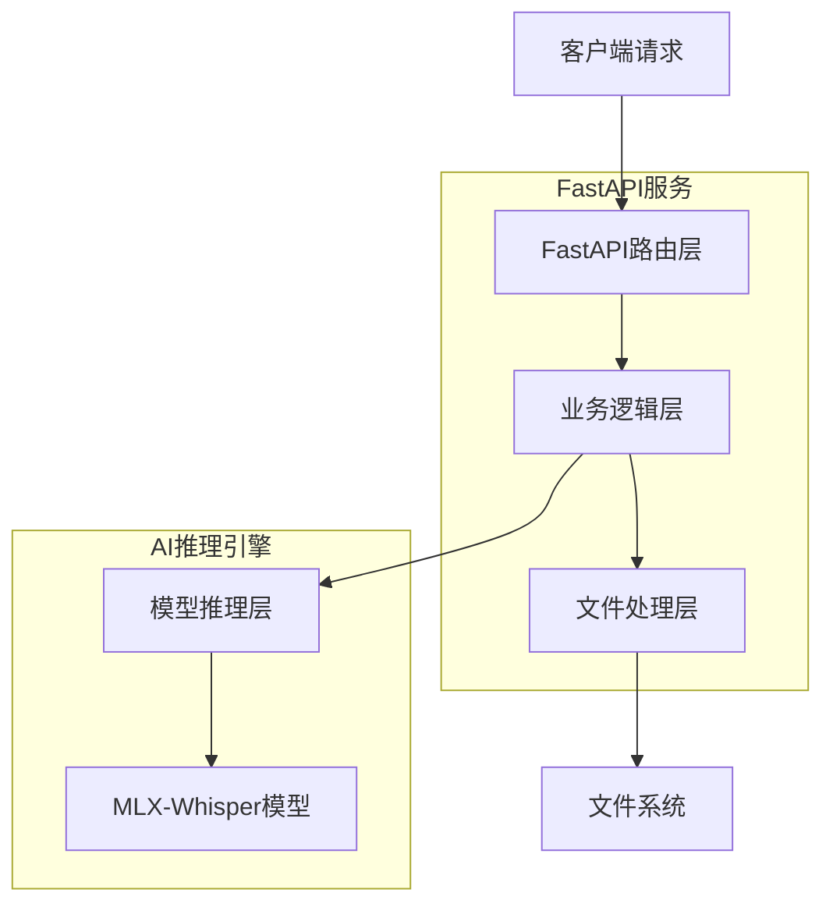
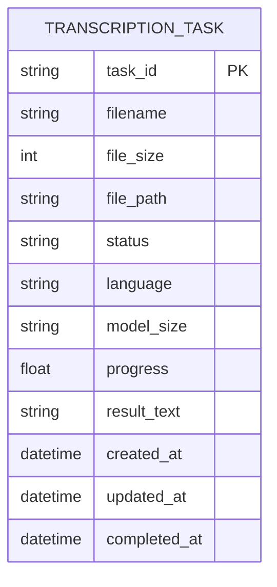

## 1. 架构设计



## 2. 技术栈描述

- **前端**: React@18 + TailwindCSS@3 + Vite
- **初始化工具**: vite-init
- **包管理**: Bun
- **后端**: Python@3.9 + FastAPI@0.104
- **AI模型**: mlx-whisper (Apple Silicon优化)
- **音频处理**: librosa, soundfile
- **文件上传**: python-multipart

## 3. 路由定义

| 路由 | 用途 |
|------|------|
| / | 主页面，音频上传和转换功能 |
| /history | 历史记录页面，查看过往转换记录 |
| /api/health | 健康检查接口 |
| /api/upload | 音频文件上传接口 |
| /api/transcribe | 语音转文字接口 |
| /api/progress/{task_id} | 查询转换进度接口 |
| /api/result/{task_id} | 获取转换结果接口 |
| /api/history | 获取历史记录接口 |
| /api/download/{task_id} | 下载结果文件接口 |

## 4. API定义

### 4.1 文件上传API

```
POST /api/upload
```

请求:
| 参数名 | 参数类型 | 是否必需 | 描述 |
|--------|----------|----------|------|
| file | File | 是 | 音频文件，支持mp3, wav, m4a, flac格式 |
| max_size | int | 否 | 最大文件大小限制，默认500MB |

响应:
| 参数名 | 参数类型 | 描述 |
|--------|----------|------|
| task_id | string | 任务唯一标识符 |
| filename | string | 文件名 |
| file_size | int | 文件大小(字节) |
| status | string | 上传状态 |

示例:
```json
{
  "task_id": "550e8400-e29b-41d4-a716-446655440000",
  "filename": "example.wav",
  "file_size": 1048576,
  "status": "uploaded"
}
```

### 4.2 语音转文字API

```
POST /api/transcribe
```

请求:
| 参数名 | 参数类型 | 是否必需 | 描述 |
|--------|----------|----------|------|
| task_id | string | 是 | 上传任务ID |
| language | string | 否 | 语言代码，默认zh |
| model_size | string | 否 | 模型大小，可选tiny, base, small, medium, large |

响应:
| 参数名 | 参数类型 | 描述 |
|--------|----------|------|
| task_id | string | 任务ID |
| status | string | 任务状态 |
| message | string | 状态描述 |

### 4.3 查询进度API

```
GET /api/progress/{task_id}
```

响应:
| 参数名 | 参数类型 | 描述 |
|--------|----------|------|
| task_id | string | 任务ID |
| progress | float | 进度百分比 |
| status | string | 当前状态 |
| estimated_time | int | 预计剩余时间(秒) |

## 5. 服务器架构图



## 6. 数据模型

### 6.1 任务数据模型



### 6.2 数据定义

转录任务表(transcription_tasks)
```python
# Pydantic模型定义
from pydantic import BaseModel
from datetime import datetime
from typing import Optional

class TranscriptionTask(BaseModel):
    task_id: str
    filename: str
    file_size: int
    file_path: str
    status: str  # pending, processing, completed, failed
    language: str = "zh"
    model_size: str = "base"
    progress: float = 0.0
    result_text: Optional[str] = None
    created_at: datetime
    updated_at: datetime
    completed_at: Optional[datetime] = None
```

### 6.3 文件存储结构
```
project/
├── uploads/          # 上传的音频文件
│   ├── {task_id}/
│   │   ├── original.{ext}
│   │   └── processed.{ext}
├── results/         # 转换结果
│   ├── {task_id}/
│   │   ├── transcript.txt
│   │   └── metadata.json
├── models/          # MLX-Whisper模型文件
│   ├── tiny/
│   ├── base/
│   ├── small/
│   ├── medium/
│   └── large/
└── logs/           # 应用日志
    ├── app.log
    └── error.log
```

## 7. MLX-Whisper集成

### 7.1 模型加载策略
- 首次使用时下载模型到本地
- 根据用户选择的模型大小加载对应模型
- 模型常驻内存，提升后续转换速度
- 支持模型热切换

### 7.2 性能优化
- 利用Apple Silicon的神经网络引擎
- 支持批量音频处理
- 实现流式识别，实时返回部分结果
- 内存管理优化，避免大文件内存溢出

### 7.3 错误处理
- 模型加载失败重试机制
- 音频格式转换自动处理
- 大文件分块处理
- 详细的错误日志记录