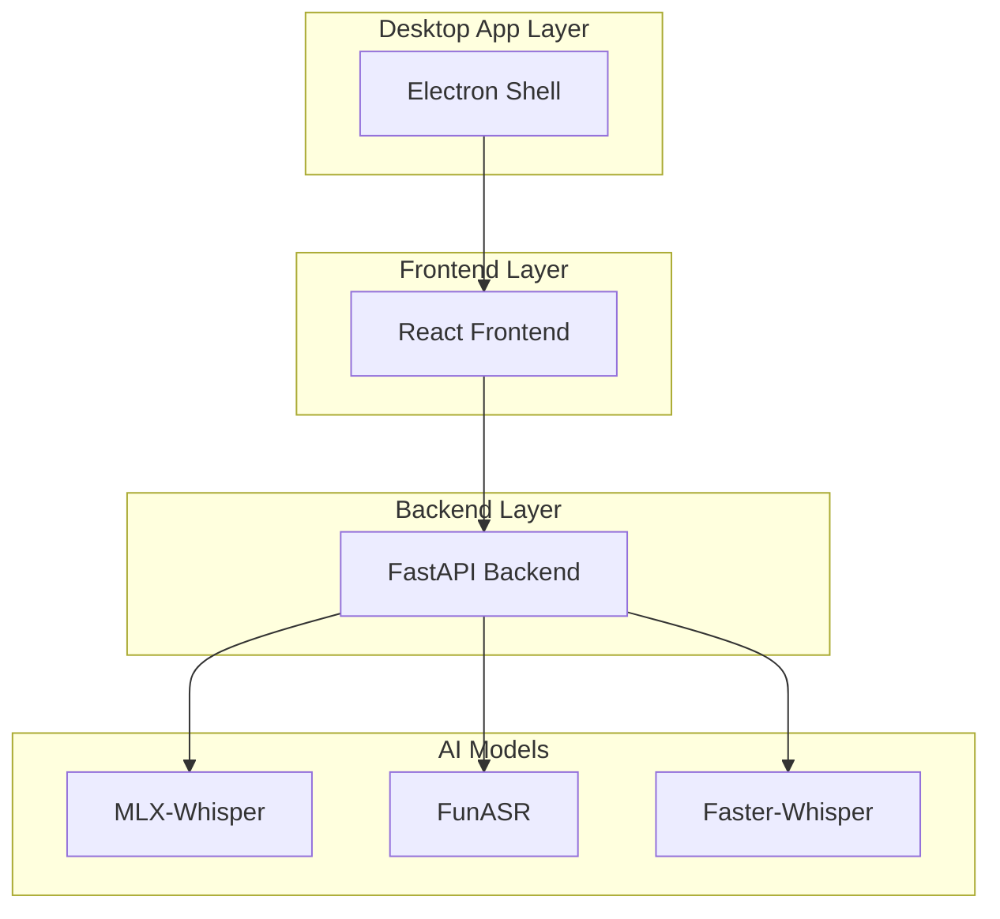
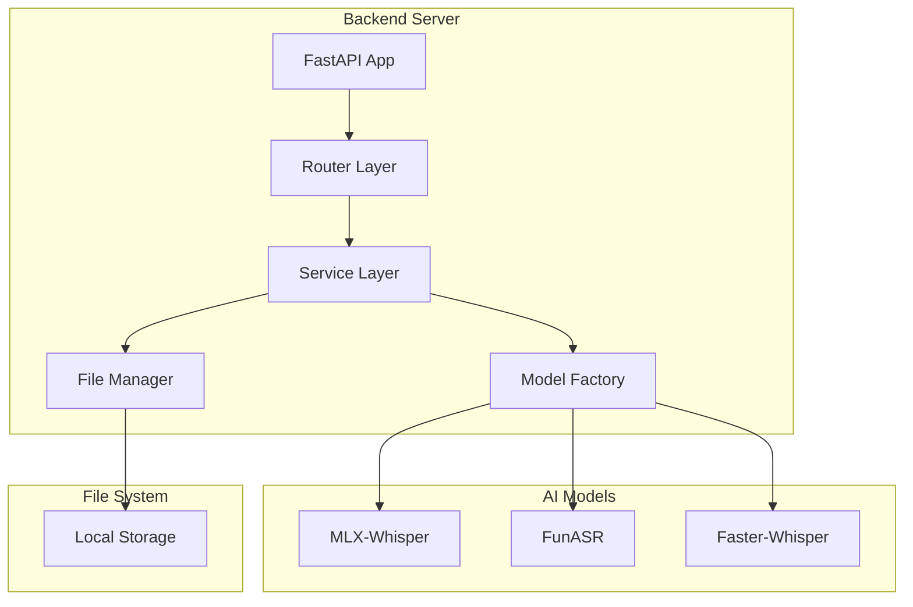
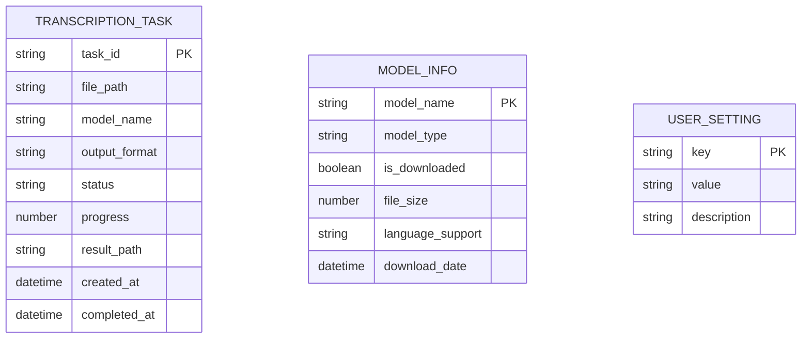

## 1. Architecture design

本地桌面应用架构，采用前后端分离设计，便于后续打包为独立应用：



## 2. Technology Description

- Frontend: React@18 + tailwindcss@3 + vite
- Initialization Tool: vite-init
- Backend: Python FastAPI
- Package Manager: bun (前端), pip (后端)
- Desktop Wrapper: Electron (后期集成)
- AI Models: MLX-Whisper, FunASR, Faster-Whisper

## 3. Route definitions

| Route | Purpose |
|-------|---------|
| / | 主界面，包含所有核心功能 |
| /settings | 设置页面，配置模型和输出选项 |
| /about | 关于页面，显示版本信息 |

## 4. API definitions

### 4.1 Core API

文件上传和转录
```
POST /api/transcribe
```

Request:
| Param Name | Param Type | isRequired | Description |
|------------|------------|------------|-------------|
| file_path | string | true | 音频文件绝对路径 |
| model | string | true | 模型名称 (mlx-whisper/funasr/faster-whisper) |
| format | string | true | 输出格式 (srt/text/markdown) |
| language | string | false | 音频语言，自动检测 |

Response:
| Param Name | Param Type | Description |
|------------|------------|-------------|
| task_id | string | 转录任务ID |
| status | string | 任务状态 |
| progress | number | 进度百分比 |

### 4.2 任务状态查询
```
GET /api/transcribe/{task_id}
```

Response:
| Param Name | Param Type | Description |
|------------|------------|-------------|
| status | string | pending/processing/completed/failed |
| progress | number | 进度百分比 |
| result | object | 转录结果 |
| error | string | 错误信息 |

### 4.3 模型管理
```
GET /api/models
```

Response:
| Param Name | Param Type | Description |
|------------|------------|-------------|
| models | array | 可用模型列表 |
| downloaded | boolean | 是否已下载 |
| size | number | 模型大小 |

## 5. Server architecture diagram

后端采用分层架构设计：



## 6. Data model

### 6.1 Data model definition



### 6.2 Data Definition Language

转录任务表
```python
# 使用SQLite本地数据库
from sqlalchemy import create_engine, Column, String, Float, DateTime, Boolean
from sqlalchemy.ext.declarative import declarative_base
from sqlalchemy.orm import sessionmaker

Base = declarative_base()

class TranscriptionTask(Base):
    __tablename__ = 'transcription_tasks'
    
    task_id = Column(String, primary_key=True)
    file_path = Column(String, nullable=False)
    model_name = Column(String, nullable=False)
    output_format = Column(String, nullable=False)
    status = Column(String, default='pending')
    progress = Column(Float, default=0.0)
    result_path = Column(String)
    created_at = Column(DateTime)
    completed_at = Column(DateTime)

class ModelInfo(Base):
    __tablename__ = 'model_info'
    
    model_name = Column(String, primary_key=True)
    model_type = Column(String, nullable=False)
    is_downloaded = Column(Boolean, default=False)
    file_size = Column(Float)
    language_support = Column(String)
    download_date = Column(DateTime)

# 初始化数据库
engine = create_engine('sqlite:///voice_to_text.db')
Base.metadata.create_all(engine)
```

## 7. Desktop App Integration

### 7.1 Electron 打包配置
```json
{
  "name": "voice-to-text",
  "version": "1.0.0",
  "main": "electron-main.js",
  "scripts": {
    "dev": "concurrently \"bun run dev\" \"python backend/main.py\"",
    "build": "bun run build && electron-builder",
    "dist": "electron-builder --publish=never"
  }
}
```

### 7.2 本地文件系统访问
- 使用绝对路径访问音频文件
- 支持拖拽文件到应用窗口
- 文件关联：注册音频文件类型关联
- 本地缓存：转录结果缓存到本地数据库