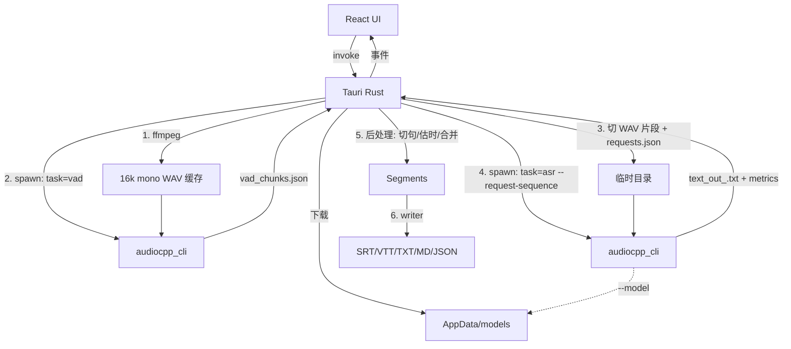

# 重构方案：用 audio.cpp 替换 Python/FunASR 推理引擎

> 状态：**Phase 0 已完成 → Go（附条件）**，见 [audiocpp-poc.md](./audiocpp-poc.md)
> 目标版本：v2.0（破坏性变更）
> 定位：个人 App，方案以"够用、好维护"为准，不做企业级的灰度/兼容/合规设计。
> 上游：[0xShug0/audio.cpp](https://github.com/0xShug0/audio.cpp)，锁定 **v0.9.1**（Apache-2.0）
> 任务拆分：[tasks.md](./tasks.md)

---

## 1. 背景与目标

### 痛点

| 问题 | 现状 |
|------|------|
| 体积 | Lite ~80MB（首次还要联网装依赖），Full ~800MB |
| 首次体验 | Lite 首次运行 `uv sync` 装 torch/funasr，约 3–5 分钟 |
| 内存 | torch + FunASR 常驻 1–2GB |
| 维护 | 三层架构 + PyInstaller hooks + 混淆 + 启动器，链路长易碎 |

### 目标

1. 用 **audio.cpp** 替换 FunASR 推理，默认模型仍为 **SenseVoice-Small**（`sense_asr`），保证中文效果不回退。
2. `audiocpp_cli` 随 App 分发；Rust 负责**模型下载、调用 VAD 取切段计划并切片、进程编排、字幕生成**。
3. 架构从三层变两层，去掉 Python 全家桶。

### 非目标

- 不改前端交互与事件契约（仅 Settings 的"环境检测/修复"改为"模型管理"）。
- 不做 streaming / 常驻服务（`audiocpp_server`）——除非实测冷启动不可接受。
- 不在首版做 Windows（见 §9）。

---

## 2. 上游调研结论（2026-10-15，基于 v0.9.1 文档与源码）

| 事项 | 结论 | 影响 |
|------|------|------|
| 预编译产物 | Release 提供 `audio-v0.9.1-bin-macos-arm64-metal.tar.gz`（30MB），内含 `audiocpp_cli`（31MB）、`audiocpp_server`、`model_specs/` | **直接使用预编译二进制**，不自建 C++ 构建链 |
| 动态依赖 | `otool -L`：仅 Metal/Accelerate/Foundation 等系统 framework + libc++，**无第三方 dylib**；Metal shader 已内嵌 | 打包只需单文件 |
| SenseVoice | `sense_asr` = SenseVoice-Small 原生移植，官方包 `FunAudioLLM/SenseVoiceSmall-GGUF-audiocpp` / `sensevoice-small-q8-audiocpp-v1.gguf`（revision `5c3fcfe7…`） | 默认模型，与现网同源 |
| SenseVoice 时间戳 | capabilities 仅 `vad_chunking`、`partial_results`；**无 word/segment 时间戳**，长音频内部 VAD 切块后**拼接成一段文本** | 必须先用 `--task vad --family silero_vad` 得到切段计划，Rust 再按采样点切片并逐段转写（§5.3） |
| SenseVoice 语言 | 只有 `zh/en/yue/ja/ko/nospeech` 会硬编码语言 token，其余语言回落 `auto` | 语言映射见 §5.6 |
| SenseVoice 选项 | `language`、`enable_itn`(默认 true)、`keep_tags`(默认 false)、`audio_chunk_mode`、`audio_chunk_duration_sec`；session `vad_model_path` 默认相对路径 `assets/framework/models/silero_vad` | 必须显式传 VAD 路径 |
| Silero VAD | `--task vad --family silero_vad`，`--vad-chunks-out` 输出切块计划，参数 `--vad-chunk-max-seconds/-merge-gap-seconds/-padding-seconds`；模型文件 `silero_vad_16k.safetensors`（1.2MB）**不在 release 包里** | 随 App 内置该文件 |
| 词级时间戳 | `qwen3_asr` + `qwen3_forced_aligner`（`--words-out` + `qwen3_asr.forced_aligner_path`）提供；`fun_asr_nano` 无时间戳 | 作为可选"精确时间戳"模型，承接 `--raw`（§5.5） |
| 说话人 | `moss_transcribe_diarize` 单模型输出带 speaker 的 turns；或 `sortformer_diar` 只做分离 | Phase 4 评估（§5.7） |
| 批处理 | `--request-sequence <json>` 在**一个会话内**跑多条请求（模型只加载一次），`--metrics` 按请求打印 `metrics[<id>]` | 一个文件的所有 VAD 段一次调用完成 |
| 许可 | audio.cpp Apache-2.0；SenseVoice 权重为 FunASR Model License v1.1（**需署名并保留模型名**）；Qwen3-ASR Apache-2.0；CrisperWhisper 非商用（排除） | 「关于」页加致谢 |

### 输出 JSON 格式（`app/workflow/file_sink.cpp`）

时间单位均为 **采样点**（16kHz 输入时 `秒 = sample / 16000`）：

```jsonc
// --vad-chunks-out
[{"index":0,"start_sample":0,"end_sample":152000}]
// --segments-out（VAD / 部分 ASR）
[{"start_sample":0,"end_sample":152000,"confidence":0.98,"text":"可选"}]
// --words-out
[{"start_sample":1200,"end_sample":5600,"word":"你好","confidence":0.9}]
// --turns-out
[{"start_sample":0,"end_sample":80000,"speaker_id":"speaker_0","confidence":0.8,"text":"可选"}]
```

`--text-out` 写纯文本；未指定文件时结果以 `key=<json>` 形式打到 stdout（我们不依赖）。

---

## 3. 现状梳理（重构必须保住的行为）

| 现有行为 | 位置 | 重构后归属 |
|----------|------|-----------|
| 前端调用 `start_transcription({id,path,output_path,format,language,enable_diarization})`，`device` 前端未传 | `src/lib/transcription.ts` | 请求结构不变 |
| 事件 `transcribe_progress` / `transcribe_complete` / `transcribe_error`，payload `TranscribeProgress{task_id,progress,status,step?,total_time?}`，4 步 `StepInfo` | `transcribe.rs`、`App.tsx` | **契约零改动**；Rust 直接 emit，删除 stdout 文本协议解析 |
| `transcribe_complete` 只在第一个输出文件写成后发一次 | `process_output_line` | 改为全部格式写完后发一次 |
| 视频由 Rust 抽 16k mono WAV，缓存在媒体目录 `*_audio.wav`（`is_cache_fresh`）；音频文件直通 | `transcribe.rs` | 保留缓存；**音频文件也统一转 WAV**（audio.cpp 只吃 WAV），删除"直通失败再回退"逻辑 |
| 多格式 `srt,vtt,txt,md,json`，首个格式用 `output_path`，其余替换后缀 | `main.py` | 照搬 |
| 断句：按标点切分、按字数估算时间、`max_duration=10s`、`max_chars=50`、`gap_threshold=0.5s` 合并短句 | `transcriber.py` | Rust 后处理（§5.4） |
| `[Speaker A]: text` 前缀 | `subtitle_writer.py` | 照搬 |
| Pro 授权：前端 `ensureMultiSpeakerLicense` + Python 读 `~/.monosub/license_state.json` 二次校验 | `transcription.ts`、`main.py`、`license.rs` | Python 校验改为 Rust `is_pro_licensed()` |
| 依赖检查/安装：`check_dependencies`、`install_dependencies`、事件 `install_progress`/`install_complete` | `transcribe.rs`、`Settings.tsx` | 删除，改为模型管理 |
| 语言 `auto/en/zh/es/ja/de/fr/pt/zh-tw/ko` | `useStore.ts` `OutputLanguage` | 映射见 §5.6 |
| 设置 `enableNoiseReduction` / `enableVolumeNormalization` / `enableBilingual` | `AppSettings` | Phase 0 确认是否仍生效；不生效则在 v2 移除 UI |

---

## 4. 目标架构（两层）



### Rust 模块划分

```
src-tauri/src/
├── commands/
│   ├── transcribe.rs     # 精简为：命令入口 + 任务表 + 事件；编排调用 engine/subtitle
│   ├── models.rs         # 新：check_models / download_model / remove_model / open_models_dir
│   ├── license.rs        # 新增 pub fn is_pro_licensed() -> bool
│   └── video.rs          # get_ffmpeg_path_for_python → get_ffmpeg_path
├── engine/               # 新
│   ├── mod.rs            # pub async fn transcribe(ctx, wav, opts) -> Result<Vec<Segment>>
│   ├── cli.rs            # audiocpp_cli 路径解析、spawn、kill、stderr 收集
│   ├── vad.rs            # 调 silero_vad，解析 vad_chunks.json
│   ├── wav.rs            # 16k s16le WAV 读取与按采样点切片（hound crate）
│   └── catalog.rs        # models.json 解析、模型路径解析
└── subtitle/             # 新
    ├── mod.rs            # Segment { start: f64, end: f64, text: String, speaker: Option<String> }
    ├── postprocess.rs    # 切句、估时、合并、长度限制
    └── writer.rs         # srt/vtt/txt/md/json
```

---

## 5. 关键设计

### 5.1 二进制与打包

- 来源：`scripts/build/fetch-audiocpp.sh` 下载 v0.9.1 release 的 `macos-arm64-metal` 包，**校验 SHA256**（脚本内写死），取出 `audiocpp_cli` 与 `LICENSE`。需要 Intel 时取 `macos-x64-metal` 包，二者 `lipo` 合成 universal。
- 放置：`src-tauri/resources/bin/audiocpp_cli-aarch64-apple-darwin`，路径解析复用 ffmpeg 的规则（dev：`src-tauri/resources/bin/`；prod：`Resources/resources/bin/`）。
- VAD 模型：`src-tauri/resources/models/silero_vad/silero_vad_16k.safetensors`，由同一脚本从上游仓库 `assets/framework/models/silero_vad/` 下载（Phase 0 实测：**v0.9.1 tag 内即可取到**，无需回溯 commit），**随 App 内置**，不走用户模型目录。
- `.gitignore` 忽略二进制与 VAD 文件，`prepare-resources.sh` 调用 fetch 脚本。
- 签名：`sign-app.sh` 对 `resources/bin/*` 逐个 `codesign --options runtime`；hardened runtime 下是否需要额外 entitlement，在 Phase 2 干净机验证。
- `tauri.conf.json`：删除 `externalBin`；`resources` 已是 `resources/**/*`，无需改。
- 自建构建（`scripts/build_metal.sh --model-set custom --models sense_asr,silero_vad`）仅作为体积优化备选，不在首版范围。

### 5.2 模型管理

- 目录：`app_data_dir()/models/<target_directory>/<files>`，与上游 `model_specs` 的 `target_directory` 一致，方便用户手动放置。
- 清单：内置 `src-tauri/resources/models.json`，从上游 `model_specs/*.json` 摘取所需字段：

```jsonc
{
  "version": 1,
  "default": "sensevoice_small_q8",
  "models": [
    {
      "id": "sensevoice_small_q8",
      "family": "sense_asr",
      "display_name": "SenseVoice Small (Q8)",
      "target_directory": "SenseVoice-Small-GGUF",
      "model_file": "sensevoice-small-q8-audiocpp-v1.gguf",
      "files": [{
        "path": "sensevoice-small-q8-audiocpp-v1.gguf",
        "url": "https://huggingface.co/FunAudioLLM/SenseVoiceSmall-GGUF-audiocpp/resolve/5c3fcfe748a8714216bc135476d5863084fddb72/sensevoice-small-q8-audiocpp-v1.gguf",
        "size": 0,          // Phase 0 填实际字节数
        "sha256": null      // Phase 0 填
      }],
      "languages": ["auto","zh","en","yue","ja","ko"],
      "capabilities": { "timestamps": "none", "diarization": false },
      "license": "FunASR Model License v1.1"
    }
  ]
}
```

- 镜像：HF 在国内不稳定，`files[].mirrors` 可选填 ModelScope / hf-mirror URL，下载按顺序回退。
- 命令（`commands/models.rs`）：

| 命令 | 签名 | 说明 |
|------|------|------|
| `list_models` | `() -> Vec<ModelStatus>` | 清单 + `installed: bool` + `size_on_disk` |
| `download_model` | `(id) -> ()` | 流式下载到 `<file>.part`，完成后校验 size（及 sha256 若有），`rename`；进度事件节流 ≥200ms |
| `cancel_model_download` | `(id) -> ()` | 中止并删除 `.part` |
| `remove_model` | `(id) -> ()` | 删除该模型目录 |
| `open_models_dir` | `() -> ()` | 复用 `open_in_finder` |

- 事件：`model_download_progress {id, downloaded, total}`、`model_download_complete {id}`、`model_download_error {id, message}`。
- 安装判定：文件存在且大小匹配（不读 sha，避免启动时哈希大文件）。
- 首次引导：`start_transcription` 检测默认模型未安装时返回特定错误码 `MODEL_NOT_INSTALLED`，前端弹出下载对话框。
- 断点续传（HTTP Range）为加分项。

### 5.3 转写流水线（每个文件）

全部临时文件放 `temp_dir()/monosub-<task_id>/`，任务结束（成功/失败/取消）整体删除。

**Step 1 提取音频**：沿用现有 ffmpeg 抽取与缓存；音频文件也走转换（命中缓存则跳过）。产物 16kHz / mono / s16le WAV。

**Step 2 取 VAD 切段计划**（在 `audiocpp_cli` 内跑 Silero VAD 推理，耗时极短）：

```bash
audiocpp_cli --task vad --family silero_vad \
  --model <res>/models/silero_vad --backend cpu \
  --audio audio.wav --vad-chunks-out vad_chunks.json \
  --vad-chunk-max-seconds 15 --vad-chunk-merge-gap-seconds 0.2 --vad-chunk-padding-seconds 0.1
```

- **VAD 算法在 CLI 里（Silero 模型），不在 Rust 里**；Rust 只拼命令、解析 `vad_chunks.json` 的采样点。
- `max 15s` 让每段文本足够短，后处理估时误差可控；merge-gap / padding 已在 P1-23 实测重调（见 [audiocpp-accuracy-p1-23.md](./audiocpp-accuracy-p1-23.md) §3.3/§3.4），**不是**设计初稿的 0.5 / 0.25。
- 空结果（全静音）→ 直接写空字幕并完成，不报错。

**Step 3 切片 + 转写**（模型加载一次）：

1. Rust 用 `hound` 读 WAV，按 `start_sample..end_sample` 切出 `chunk_0000.wav …`。
2. 生成 `requests.json`。**逐请求选项必须写在这里**，不能用 `--request-option`（Phase 0 实测：sequence 模式下 CLI 不解析 `--request-option`，随后按未识别参数报错 `unknown options`——详见 [PoC §4.1](./audiocpp-poc.md)）：

```jsonc
{"requests":[
  {"id":"c0000","audio":"chunk_0000.wav","language":"zh",
   "options":{"audio_chunk_mode":"none"}},
  …
]}
```

`audio` 字段名、顶层 `language`、`options` 映射均已实测确认。相对路径以 `requests.json` 所在目录为 base。

3. 调用：

```bash
audiocpp_cli --task asr --family sense_asr --model <gguf> --backend metal \
  --request-sequence requests.json --text-out out/text.txt \
  --session-option sense_asr.vad_model_path=<res>/models/silero_vad \
  --threads <物理核数> --metrics
```

4. 每段文本从 CLI 打印的 `text_out[<id>]=<path>` 行取路径（命名规则 `<stem>_<safe_id><ext>`，`safe_output_name` 会把非 `[A-Za-z0-9_-]` 转成 `_`）。直接解析该行比自行拼接更稳。
5. 进度：逐行读 stdout，匹配 `metrics[<id>].` 计数 → `progress = done / total`，emit 到 Step 3。**Phase 0 确认 metrics 逐条实时输出**，无需退化。

**Step 4 后处理 + 写文件**：见 §5.4。

**后端选择**：`auto→metal`（macOS），失败（退出码非 0 且 stderr 含 metal/backend 关键词）自动用 `cpu` 重试一次，并 `MSG` 提示。`device` 参数前端当前未传，保持 `auto`。

**取消**：`TaskMap` 中保存 `JoinHandle` + `Child`；`cancel_transcription` 先 `child.start_kill()` + `wait()`，再 abort 任务，清理临时目录与已写出的部分字幕。

**错误文案**（`transcribe_error.status`）：

| 场景 | 判定 | 文案 key |
|------|------|---------|
| 模型未安装 | 启动前检查 | `errors.modelNotInstalled` |
| 二进制缺失/无执行权限 | spawn 失败 | `errors.engineMissing` |
| 推理失败 | 非 0 退出 | `errors.engineFailed` + stderr 末 5 行（写日志，UI 截断 200 字） |
| 音频提取失败 | ffmpeg 非 0 | `errors.audioExtractFailed` |

### 5.4 后处理与字幕输出（`subtitle/`）

输入：`Vec<(chunk_start_s, chunk_end_s, text)>`；输出：`Vec<Segment>`。

1. **清洗**：去掉残留 `<|...|>` 标签（`keep_tags=false` 时理论上没有，兜底），trim，空文本丢弃。
2. **切句**：按句末标点（`。！？!?；;` 及 `.` 后跟空格）切分；仍超过 `max_chars=50` 的再按 `，,、` 切；仍超长则硬切（CJK 按字，拉丁按词）。
3. **估时**：段内按"有效字符数"（CJK 1、拉丁单词 1、标点 0）比例分配 `[chunk_start, chunk_end]`，保证单调且不越界。
4. **合并**：相邻句间隔 < `gap_threshold=0.5s` 且合并后 ≤ `max_chars`、≤ `max_duration=10s` 时合并。
5. **约束**：每条最短 0.3s；相邻不重叠。

字幕写入（`writer.rs`）照搬 `subtitle_writer.py`：
- SRT `HH:MM:SS,mmm`，VTT `WEBVTT` 头 + `HH:MM:SS.mmm`，TXT 每行一句，MD 带时间戳列表，JSON `[{start,end,text,speaker?}]`（字段名与 Python 版一致，Phase 1 对照确认）。
- 时间戳用 `(seconds * 1000.0).round() as u64` 整数毫秒计算。
- 说话人：`[Speaker A]: text`。

测试：`core-engine/test_transcript.*` 和 `srt-example/` 拷贝到 `src-tauri/tests/fixtures/`，覆盖 writer 各格式、切句、估时、合并（项目首批 `cargo test`）。

### 5.5 精确时间戳模型（可选）与 `--raw`

- 清单中增加 `qwen3_asr_0_6b_q8_0` + `qwen3_forced_aligner_0_6b_q8_0`（标为"精确时间戳 / 较大"），`capabilities.timestamps = "word"`。
- 走该模型时**跳过 VAD 与切片两步**，直接：

```bash
audiocpp_cli --task asr --family qwen3_asr --model <dir> --backend metal --audio audio.wav \
  --words-out words.json --text-out text.txt \
  --session-option qwen3_asr.forced_aligner_path=<aligner.gguf> \
  --request-option preserve_punctuation=true
```

- 词序列 → 按标点/停顿 > 0.5s/`max_chars` 组句，时间取首尾词。
- `--raw`（Scribe 兼容词级 JSON，供外部 `pack_transcripts.py`）只在该模型下提供；SenseVoice 下不提供。前端当前未暴露 `--raw`，因此作为 Phase 4 事项，**不阻塞主线**。

### 5.6 语言映射

| App `OutputLanguage` | sense_asr `language` | qwen3_asr `language` |
|----------------------|---------------------|----------------------|
| `auto` | `auto` | 不传 |
| `zh` | `zh` | `zh` |
| `zh-tw` | `zh`（**Phase 0 已确认**：现状 FunASR 与 audio.cpp 均输出简体，无回归；OpenCC 繁转为可选增强 P4-5） | `zh` |
| `en` / `ja` / `ko` | 同值 | 同值 |
| `es` / `de` / `fr` / `pt` | `auto`（模型仅硬编码 5 种语言） | 同值 |

映射函数放 `engine/catalog.rs`，按 `models.json` 的 `languages` 判定，不支持的回落 `auto`。

> **Phase 0 修正**：`sense_asr` 的 `is_language_tag()` 实际接受 **23 种**语言标签（不会因传 `es`/`de` 等报错），但 `language_query_token()` 只把 `{auto, zh, en, yue, ja, ko, nospeech}` 映射为真实 token，其余一律返回 `0`（= auto）。因此**结论（回落 auto）正确，机制描述需修正**：`models.json` 的 `languages` 应填完整 23 项（决定 CLI 是否报错），而「映射到 auto」需在 `map_language` 里单独实现，不能依赖 CLI。

### 5.7 说话人分离与授权

> ⚠️ **本节已由 [model-selection-design.md](./model-selection-design.md) 取代**。
> 下面保留为历史记录；实现请以新文档的「需求 → ModelPlan 求解器」为准。

- 授权：`license.rs` 新增 `pub fn is_pro_licensed() -> bool`（解密 `license_state.json`，校验 `valid`、签名、`expires_at` 未过期）。
- v2.0 首版曾计划**多说话人暂时下线**（开关置灰）——**已废弃**，改为可选的模型方案。
- 原始设想的两条路径存在事实错误，更正如下：
  1. `moss_transcribe_diarize`（单模型出 turns+text，Apache-2.0；模型较大，需测中文与速度）—— 成立，且**推荐**（见新文档 §6）。
  2. `sortformer_diar` 出 turns → 重叠归属 —— **v1 是 CC-BY-NC-4.0**（新文档 §2.2 已澄清；个人学习项目可用，但需显式标注）。
- **不存在第三条路**：audio.cpp v0.9.1 的 114 个 family 里没有 `spk`/`sv` 任务，也没有 CAM++ loader，旧 Python 方案无法复现。
- 更小的 diar-only 备选：`nemotron_3_diar`（107 MB，OpenMDW 1.1，≤8 人），体积比 sortformer 小。
- 另外 `fun_asr_nano` **不提供**说话人分离（其 `Timestamps: Not exposed`，FunASR 的 “+CAM++” 是 Python 侧编排）。

### 5.8 并发与冷启动

- 保留 `AUDIO_SEMAPHORE(2)`、`TRANSCRIBE_SEMAPHORE(1)`。
- 每文件一次 VAD 调用 + 一次 ASR 调用（`--request-sequence` 保证文件内只加载一次模型）。
- 用 `--metrics` 记录到日志：加载耗时、wall、RTF。若批量小文件场景加载占比 > 30%，再评估跨文件 request-sequence 或 `audiocpp_server`。

### 5.9 前端改动

- `Settings.tsx`：删除依赖检查/安装区块与 `install_progress`/`install_complete` 监听；新增"模型"区块：模型列表（名称、大小、状态、下载/取消/删除按钮、进度条）、"打开模型目录"、许可证致谢链接。
- `transcription.ts`：处理 `MODEL_NOT_INSTALLED` 错误 → 打开 Settings 模型区块或弹窗。
- 多说话人开关：首版置灰 + tooltip。
- i18n：新增 `models.*`、`errors.*` key，**24 个 locale 全部补齐**（英文兜底，其余机翻后人工抽查 zh-CN/zh-TW/ja）。
- Store：持久化中若有已废弃字段，`persist` 增加 `version: 2` + `migrate` 丢弃。

---

## 6. 分阶段实施

详见 [tasks.md](./tasks.md)。概览：

| Phase | 内容 | Go/验收 |
|-------|------|---------|
| 0 可行性验证 | 预编译 CLI 跑通 VAD + SenseVoice request-sequence；与 FunASR 对比 | 中文效果、耗时、内存不劣于现状；产出 `audiocpp-poc.md` |
| 1 引擎替换 | engine / subtitle / models / license / transcribe 重写 / 前端模型管理 | check/lint/cargo test 通过；事件契约一致 |
| 2 打包 | fetch 脚本、签名、删 Python 构建链 | 干净机 DMG 下载模型即可转写 |
| 3 清理 | 删 `core-engine/`、文档更新 | `rg` 无残留 |
| 4 可选增强 | 精确时间戳模型、`--raw`、多说话人回归 | 按需 |

---

## 7. 风险与开放问题

| # | 风险 | 处置 |
|---|------|------|
| 1 | `--request-sequence` 对 ASR 的 `audio` 字段 / text_out 命名与文档推断不符 | Phase 0 首个验证项；备选 `--batch-audio-dir` + `--batch-manifest-out`；再不行退化为每段一次调用（实测加载耗时） |
| 2 | VAD 切段 + 比例估时导致字幕时间精度低于现状 | 现 SenseVoice 路径同样是估时，Phase 0 主观对比；不满意则调小 `max_seconds` 或推荐 qwen3 精确模型 |
| 3 | 段边界切断词句 | padding 0.25s + merge gap；后处理合并跨段短句 |
| 4 | HF 下载在国内慢/失败 | mirrors 回退 + 手动放置 |
| 5 | 预编译二进制 Gatekeeper/公证问题 | 重签名 + 公证；干净机验证 |
| 6 | 上游迭代快、接口变化 | 锁定 v0.9.1 + SHA256；升级单独评估并跑 Phase 0 脚本回归 |
| 7 | ~~`zh-tw` 输出简繁不符预期~~ | **Phase 0 已关闭**：现状 FunASR 同样输出简体，无回归 |
| 10 | **中文准确率未充分对照**（Phase 0 唯一缺口） | 已实测速度/内存大幅优于现状，但准确率仅单样例、且对 VAD `padding` 敏感。**发版前必须用真实素材补测**；若不达标，评估默认切换 `qwen3_asr`（P4-1） |
| 8 | ~~多说话人下线影响 Pro 用户~~ | **已关闭**：改为需求驱动的 ModelPlan，见 [model-selection-design.md](./model-selection-design.md) |
| 9 | 长音频（≥2h）切片数量多、临时文件大 | 切片总大小 ≈ 原 WAV；必要时分批 sequence（每批 200 段） |

---

## 8. 验收目标

- DMG 体积 < 60MB（CLI 31MB + ffmpeg + App）；首次可用只需下载 SenseVoice 模型（约 250MB，Phase 0 实测）；无 Python。
- 内存峰值与速度**不劣于**现状（以 Phase 0 实测为准）。
- 中文准确率与 FunASR SenseVoice 主观对比不劣。
- 前端事件契约零改动；多格式输出与 Python 版黄金样例一致（时间戳差异仅来自模型）。

---

## 9. 回退与范围外

- Phase 3 之前不删除 `core-engine/`，可 git 回退。不做运行时双引擎开关。
- Phase 0 No-Go：保留 Rust 字幕模块与模型下载框架，推理继续 FunASR。
- Windows：上游有 `windows-x64-cpu/vulkan` 预编译包，架构可复用，但打包/签名单独立项。

---

## 附：关键文件

| 文件 | 角色 |
|------|------|
| `src-tauri/src/commands/transcribe.rs` | 转录入口（重写） |
| `src-tauri/src/commands/video.rs` | ffmpeg/ffprobe 路径解析 |
| `src-tauri/src/commands/license.rs` | 授权判断 |
| `src-tauri/src/commands/update.rs` | `reqwest` 用法参考 |
| `src-tauri/src/main.rs` | 命令注册 |
| `src/lib/transcription.ts` | 前端调用入口 |
| `src/components/Settings.tsx` | 改为模型管理 |
| `core-engine/monosub_core/transcriber.py` | 断句逻辑移植来源 |
| `core-engine/monosub_core/subtitle_writer.py` | 字幕写入移植来源 |
| `scripts/build/prepare-resources.sh` | 构建前资源编排 |
| `scripts/release/sign-app.sh` | 签名 |

## 参考

- [audio.cpp 仓库](https://github.com/0xShug0/audio.cpp) · [ASR 文档](https://github.com/0xShug0/audio.cpp/blob/main/docs/asr.md) · [CLI 用法](https://github.com/0xShug0/audio.cpp/blob/main/docs/usage.md) · [模型许可](https://github.com/0xShug0/audio.cpp/blob/main/docs/model_licenses.md)
- [SenseVoiceSmall-GGUF-audiocpp](https://huggingface.co/FunAudioLLM/SenseVoiceSmall-GGUF-audiocpp)
