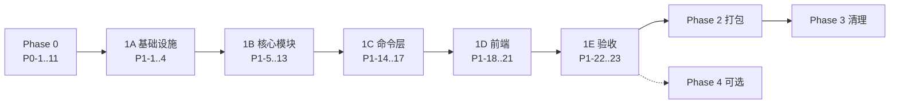

# Tasks：audio.cpp 引擎替换

> 设计见 [refactor-audiocpp.md](./refactor-audiocpp.md)（下称 spec）。
> 约定：每个任务独立可提交；`依赖` 列出必须先完成的任务；勾选即完成。
> 粒度：S ≤ 半天，M ≈ 1 天，L ≈ 2–3 天。

---

## Phase 0 — 可行性验证（Go/No-Go）

目标：用预编译 CLI 跑通完整流水线，拿到数据决定是否继续。全部在 `poc/`（不入库，或放 `scripts/poc/`）手工完成。

| ID | 任务 | 规模 | 依赖 | 验收 |
|----|------|------|------|------|
| P0-1 | 下载 v0.9.1 `macos-arm64-metal` 包，记录 SHA256；`--list-loaders --json` 确认含 `sense_asr`、`silero_vad`、`qwen3_asr` | S | — | 命令输出存档 |
| P0-2 | 下载 `silero_vad_16k.safetensors` 与 SenseVoice Q8 GGUF，记录字节数与 SHA256 | S | — | 填入 spec §5.2 清单草稿 |
| P0-3 | 单文件直跑：`--task asr --family sense_asr --audio <30s 中文>`，确认 `--text-out`、`language`、`enable_itn`、`--metrics` 行为 | S | P0-1,2 | 输出文本 + metrics 样例 |
| P0-4 | VAD：`--task vad --family silero_vad --vad-chunks-out`，确认 JSON 格式与参数效果（max 10/15/20s 对比） | S | P0-1,2 | `vad_chunks.json` 样例 |
| P0-5 | **关键**：`--request-sequence` 跑多段 ASR，确认 ① 请求 JSON 的音频字段名 ② `--text-out` 按 id 命名规则 ③ `metrics[<id>]` 是否逐条实时输出。不支持则测 `--batch-audio-dir` | M | P0-3,4 | 结论写入 PoC 文档；若都不行，测每段一次调用的加载耗时 |
| P0-6 | 写 `scripts/poc/run_pipeline.py`（仅 PoC 用）：VAD → 切片 → sequence → 拼接 → 简易 SRT | M | P0-5 | 能对任意视频产出 SRT |
| P0-7 | 评测集：3 个样例（≥1h 长音频、多人对话、中英混合）。对比现 FunASR（v1.1.38）与 PoC：主观准确率、时间轴观感、wall time、RTF、内存峰值（`/usr/bin/time -l`）、冷启动 | M | P0-6 | 数据表 |
| P0-8 | 确认 `zh-tw` 现状行为（FunASR 输出简/繁）与 audio.cpp 输出 | S | P0-3 | 结论 |
| P0-9 | 确认 `enableNoiseReduction`/`enableVolumeNormalization`/`enableBilingual` 在现版本是否实际生效 | S | — | 结论：保留/移除 |
| P0-10 | （可选）跑 `qwen3_asr` + forced aligner 的 `--words-out`，记录模型体积与速度 | S | P0-1 | 数据 |
| P0-11 | 产出 `docs/tech-spec/audiocpp-poc.md`：数据、JSON 样例、Go/No-Go 结论；回填 spec 中所有"Phase 0 确认"项 | S | P0-1..10 | 文档合入 |

**Go 条件**：中文准确率主观不劣；时间轴可用；速度与内存不劣于现状；P0-5 有可行方案。

---

## Phase 1 — 引擎替换

### 1A. 基础设施（可并行）

| ID | 任务 | 规模 | 依赖 | 验收 |
|----|------|------|------|------|
| P1-1 | `scripts/build/fetch-audiocpp.sh`：下载 release（校验 SHA256）、解出 `audiocpp_cli` → `src-tauri/resources/bin/audiocpp_cli-aarch64-apple-darwin`；下载 silero VAD → `src-tauri/resources/models/silero_vad/`；幂等；更新 `.gitignore` | S | P0-11 | 重复运行无副作用 |
| P1-2 | `src-tauri/resources/models.json`：SenseVoice 条目（字段见 spec §5.2，填实测 size/sha256，配置镜像 URL） | S | P0-11 | JSON 可被 P1-5 解析 |
| P1-3 | `video.rs`：`get_ffmpeg_path_for_python` → `get_ffmpeg_path`（ffprobe 同理），更新所有调用 | S | — | `cargo check` |
| P1-4 | `Cargo.toml` 增加 `hound`（WAV）、`futures-util`（下载流）；`reqwest` 加 `stream` feature | S | — | `cargo check` |

### 1B. Rust 核心模块

| ID | 任务 | 规模 | 依赖 | 验收 |
|----|------|------|------|------|
| P1-5 | `engine/catalog.rs`：解析 `models.json`；`model_path(id)`、`is_installed(id)`（文件存在 + size 匹配）；`map_language(model, app_lang)`（spec §5.6） | S | P1-2 | 单测：语言映射表全覆盖 |
| P1-6 | `engine/cli.rs`：`resolve_cli_path(app)`（dev/prod，复用 ffmpeg 规则）、`resolve_vad_path(app)`；`spawn(args) -> Child`，stdout 行回调，stderr 尾部 ring buffer（50 行）；退出码映射为 `EngineError` | M | P1-1 | 能跑 `--help` |
| P1-7 | `engine/wav.rs`：读取 16k mono s16le WAV；`slice(start_sample, end_sample, out_path)`；校验采样率/声道，不符返回错误 | S | P1-4 | 单测：切片长度正确 |
| P1-8 | `engine/vad.rs`：调用 silero_vad 生成 `vad_chunks.json` 并解析为 `Vec<Chunk{index,start_sample,end_sample}>`；参数常量化 | S | P1-6 | 对样例 WAV 返回非空 |
| P1-9 | `engine/mod.rs::transcribe(ctx, wav, opts)`：临时目录 → VAD → 切片 → `requests.json` → ASR sequence → 读每段文本 → `Vec<RawChunk{start_s,end_s,text}>`；进度回调（done/total）；metal 失败自动 cpu 重试一次；取消时 kill 子进程；Drop 时删临时目录 | L | P1-5..8 | 对样例视频返回分段文本 |
| P1-10 | `subtitle/postprocess.rs`：清洗、切句、按有效字符估时、合并、约束（spec §5.4） | M | — | 单测：中文/英文/混合/超长句/空文本 |
| P1-11 | `subtitle/writer.rs`：srt/vtt/txt/md/json + speaker 前缀；整数毫秒时间戳 | M | — | 单测：与 `tests/fixtures/` 中 Python 版输出逐字一致 |
| P1-12 | 拷贝 `core-engine/test_transcript.*`、`srt-example/` 到 `src-tauri/tests/fixtures/`；必要时用现 Python writer 生成各格式黄金文件 | S | — | fixtures 入库 |
| P1-13 | `license.rs`：`pub fn is_pro_licensed() -> bool`（解密、校验 sig、`valid`、`expires_at`）；单测（用 `write_license_state` 写临时 HOME） | S | — | 单测通过 |

### 1C. 命令层

| ID | 任务 | 规模 | 依赖 | 验收 |
|----|------|------|------|------|
| P1-14 | `commands/models.rs`：`list_models`、`download_model`（`.part` + size/sha 校验 + rename + 节流进度 + 镜像回退）、`cancel_model_download`、`remove_model`、`open_models_dir`；事件 `model_download_*` | M | P1-4,5 | 手动下载 SenseVoice 成功；取消后无残留 `.part` |
| P1-15 | 重写 `transcribe.rs`：保留 `TranscribeRequest`/`TranscribeProgress`/`StepInfo`、`TASKS`、两个信号量、音频缓存逻辑；音频文件也转 WAV；模型未装返回 `MODEL_NOT_INSTALLED`；diarization 用 `is_pro_licensed` 校验（首版直接返回"暂不可用"）；按 4 步 emit；全部格式写完后发 `transcribe_complete`（带 `total_time`）；删除 `is_dev_mode`/`run_sidecar`/`run_dev_mode`/`process_output_line`/`check_dependencies`/`install_dependencies` | L | P1-9,10,11,13 | 单文件端到端事件流与旧版一致（用 App 日志对照） |
| P1-16 | `cancel_transcription`：kill 子进程 + abort + 清理临时目录与部分输出 | S | P1-15 | 转写中取消，无僵尸进程（`ps` 验证） |
| P1-17 | `main.rs`：注册新命令、移除旧命令 | S | P1-14,15 | `cargo check` |

### 1D. 前端

| ID | 任务 | 规模 | 依赖 | 验收 |
|----|------|------|------|------|
| P1-18 | `Settings.tsx`：删除依赖检查/安装 UI 与监听；新增模型区块（列表、下载/取消/删除、进度、打开目录、许可致谢） | M | P1-14 | 手动操作全流程 |
| P1-19 | `transcription.ts`：处理 `MODEL_NOT_INSTALLED` → 打开模型下载入口；多说话人开关置灰 + tooltip | S | P1-15,18 | 未装模型时点击开始有引导 |
| P1-20 | i18n：新增 `models.*`、`errors.*`、多说话人"即将回归"等 key，24 个 locale 补齐；删除依赖安装相关废弃 key | M | P1-18,19 | 脚本校验各 locale key 集合一致 |
| P1-21 | Store：`persist` 加 `version` + `migrate`，丢弃 P0-9 确认废弃的字段 | S | P0-9 | 旧 localStorage 启动不报错 |

### 1E. 验收

| ID | 任务 | 规模 | 依赖 | 验收 |
|----|------|------|------|------|
| P1-22 | 全量检查：`bun run check`、`bun run lint`、`cargo check`、`cargo test`、`cargo clippy` | S | 1A–1D | 全绿 |
| P1-23 | 手工回归：视频/音频/全静音/≥1h 长文件；5 种格式；多文件队列；跳过已存在；取消；缺模型；Metal 不可用（强制 cpu） | M | P1-22 | 回归清单全部通过 |

---

## Phase 2 — 打包

| ID | 任务 | 规模 | 依赖 | 验收 |
|----|------|------|------|------|
| P2-1 | `prepare-resources.sh` 调用 `fetch-audiocpp.sh` + ffmpeg 准备；移除 Python/uv/engine 步骤；清理 `src-tauri/resources/{python,core-engine,lib,uv,monosub-engine-*}` | S | P1-1 | 资源目录只剩 bin/ffmpeg/ffprobe/audiocpp_cli、models/silero_vad、models.json |
| P2-2 | `tauri.conf.json` 删除 `externalBin`；`build-macos-app.sh` 去掉 lite/full 分支；`package.json` 精简 `build:dmg*` 脚本 | S | P2-1 | `bun run build:dmg` 产出 DMG |
| P2-3 | 删除 `prepare-python-env.sh`、`generate-launcher.sh`、`launcher-template.sh`、`prepare-engine.sh`、`obfuscate.sh` 及 `scripts/README.md` 中的对应说明 | S | P2-2 | 无引用残留 |
| P2-4 | `sign-app.sh`：对 `Contents/Resources/resources/bin/*` 逐个 `codesign --force --options runtime --timestamp`，再签 App；公证 | S | P2-2 | `codesign --verify --deep --strict` 通过；`spctl -a` 通过 |
| P2-5 | 干净机（新用户账户、无 Homebrew/Python）安装验证：首次启动 → 下载模型 → 转写 | S | P2-4 | 全流程成功，记录 DMG 体积与内存 |
| P2-6 | 「关于」页加 audio.cpp（Apache-2.0）与 SenseVoice（FunASR Model License，署名 + 模型名）致谢；`LICENSE` 文件随包 | S | — | 页面可见 |

---

## Phase 3 — 清理

| ID | 任务 | 规模 | 依赖 | 验收 |
|----|------|------|------|------|
| P3-1 | 删除 `core-engine/`、`scripts/setup/` 中 Python 相关脚本、`package.json` 中 Python 脚本 | S | P2-5 | — |
| P3-2 | 更新 `AGENTS.md`：两层架构图、IPC 表（新增 models 命令/事件、删除 install 相关、删除 stdout 协议）、Key Files、环境变量、开发命令 | S | P3-1 | — |
| P3-3 | 更新 README、版本号 `2.0.0`（`bump-version.sh`）、发版说明（多说话人暂时下线、需下载模型） | S | P3-1 | — |
| P3-4 | 残留检查：`rg -i "funasr|core-engine|\.venv|monosub-engine|uv sync|install_dependencies"`（历史文档除外） | S | P3-1..3 | 无输出 |

---

## Phase 4 — 可选增强（按需）

| ID | 任务 | 规模 | 依赖 | 说明 |
|----|------|------|------|------|
| P4-1 | 精确时间戳模型：清单加 `qwen3_asr_0_6b_q8_0` + forced aligner；`engine` 增加 words 路径（跳过 VAD，`--words-out`）；词→句组装 | L | P1-15 | spec §5.5 |
| P4-2 | `--raw` Scribe 兼容词级 JSON 输出（仅 P4-1 模型可用），对齐外部 `pack_transcripts.py` | M | P4-1 | |
| P4-3 | 多说话人回归：评估 `moss_transcribe_diarize` vs `sortformer_diar` + 重叠归属，选型后实现，恢复开关 | L | P1-15 | spec §5.7 |
| P4-4 | 断点续传（HTTP Range） | S | P1-14 | |
| P4-5 | `zh-tw` 繁体转换（若 P0-8 显示需要） | S | P0-8 | |
| P4-6 | 冷启动优化：跨文件 sequence 或 `audiocpp_server` 常驻（若 P1-23 实测加载占比 > 30%） | L | P1-23 | |
| P4-7 | Windows 打包（上游 `windows-x64-cpu/vulkan` 预编译） | L | P2-5 | 独立立项 |

---

## 依赖关系总览

可并行：P1-3/P1-4/P1-10/P1-11/P1-12/P1-13 不依赖 Phase 0 结论，可提前开工。
